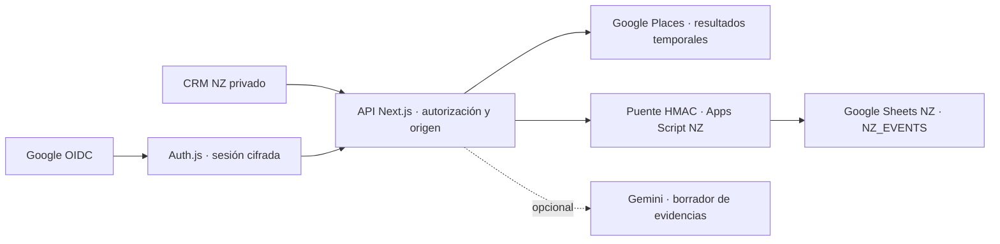

# Brand Experience CRM NZ · MVP 001

Auditoría: 14 octubre 2026. Base remota `origin/main`, commit `1c95213`.
Rama: `feat/brand-experience-crm-nz`. Proyecto existente: `brandxp`.

## Arquitectura observada y decisión

El repositorio contiene Brand Experience OS (FastAPI en `backend/`, React/Vite
en `frontend/`) y el ecosistema público Next.js 16.2.9/React 19 en
`viptour-buzios/`. Vercel identifica `brandxp` como Next.js, conectado a BRANDXP;
el preview inspeccionado procede de Git y tiene protección SSO
`all_except_custom_domains`. RioVibesTransfer forma parte de sus dominios.
La configuración de Vercel, sus dominios y la rama de producción no se cambiaron.

`/brandexperience` ya sirve Brand Experience OS mediante un iframe;
`/brand-experience` contiene el portafolio. Se agrega la ruta privada
`/brandexperience/crm-nz`, sin trasladar aplicaciones. Las únicas modificaciones
a componentes compartidos excluyen **esta nueva ruta** de la navegación pública
y de los observadores. El comportamiento de todas las demás rutas se conserva.

El checkout inicial tenía numerosos cambios de trabajos previos. Se creó un
worktree limpio desde la rama remota; esos cambios no forman parte de este PR.

El backend del CRM reside en Route Handlers de la aplicación existente. No
depende de que el servidor FastAPI esté encendido y no cambia sus integraciones.
Todas las claves son variables del servidor, protegidas por `server-only`.
No hay variables públicas de credenciales, almacenamiento local de contactos
ni modo demostración que permita eludir la autenticación.

## Sheets y Apps Script

Se inspeccionaron exclusivamente metadatos y cabeceras del CRM de referencia:
9 pestañas; `CRM` tiene 45 columnas que incluyen negocio, rubro, zona, fuentes,
contacto, respuesta, seguimiento, estado, valor, puntuación y análisis visual.
`crm2` contiene una estructura parcial de mensajería; `ANALISIS GEMINI` contiene
cliente, Instagram y análisis. No se descargaron filas comerciales para pruebas.

Se creó una copia independiente en una carpeta privada del propietario y se
verificó que sólo el propietario tiene acceso. Se agregó `NZ_EVENTS` con cinco
cabeceras y ninguna operación comercial; la zona horaria es Pacific/Auckland.
Las pestañas copiadas quedan como referencia y **no se leen desde la aplicación**.
No se importan automáticamente datos de Places ni puntuaciones Gemini antiguas.

No se encontraron archivos Apps Script del CRM original en Git y el conector
disponible no entrega el código vinculado. Por ello no se afirma que se hayan
auditado o resuelto sus duplicados. Se entrega un puente NZ aislado, con una sola
implementación `doPost` y funciones internas bajo namespaces, para instalar en
un proyecto Apps Script independiente. La adaptación de funciones originales
queda pendiente de disponer de su código. Nunca instalarlo en el proyecto original.

El libro NZ se usa como registro append-only de eventos JSON. Una operación y su
identidad/fecha se guardan juntas mediante un único append protegido por
LockService. Los snapshots se reconstruyen y filtran por responsable. Los UUID
de operación dan idempotencia, incluso si el servidor pierde una respuesta; las
revisiones previenen sobrescribir una ficha que cambió. El JSON evita interpretar
las notas como fórmulas. El piloto se limita a 20.000 eventos y requiere archivo
o migración al superar esa capacidad.

## Permisos

| Rol           | Fichas y actividades                         | Asignación                | Finanzas           |
| ------------- | -------------------------------------------- | ------------------------- | ------------------ |
| Administrador | Todas                                        | Ben, Cassia o sin asignar | Lectura y registro |
| Ben           | Sólo asignadas a Ben; puede crear propias    | Sólo a sí mismo           | Denegadas          |
| Cassia        | Sólo asignadas a Cassia; puede crear propias | Sólo a sí misma           | Denegadas          |

Los roles se resuelven por allowlist del servidor y nuevamente en Apps Script;
nunca por valores enviados por el navegador. La allowlist se revalida en cada
petición. Google debe proporcionar email verificado; cuentas externas a Gmail/
Workspace requieren un `sub` fijado. Se recomienda fijarlo para todos los usuarios.
El login pide sólo `openid email profile`, no permiso del usuario para leer Drive.
Sesiones cifradas de 8 horas, cookies HttpOnly/SameSite, PKCE/state/nonce de Auth.js,
CSRF de la biblioteca para login y origen exacto para las operaciones CRM.

## Evidencias, Places y finanzas

Places se consulta en el servidor, con máscara explícita y filtro de país NZ.
No se cachean ni persisten sus nombres, direcciones, ratings, reseñas o respuestas.
La UI muestra atribución Google Maps y atribuciones de terceros; conserva los
resultados en memoria y los retira a los cinco minutos. Sólo puede trasladar al
formulario el Place ID. Los datos CRM requieren una fuente independiente y fecha
de verificación, evitando URLs de Google Maps como fuente comercial. La revisión
de procedencia sigue siendo responsabilidad humana; una URL no prueba por sí
misma que una observación sea verdadera. Límites bajo lock: 30 búsquedas y
10 solicitudes Gemini por usuario/día UTC. Las llamadas fallidas consumen reserva.

Prioridad explicable: web ausente 40, rediseño 30, branding 20; evidencia válida
90 días, sin duplicar tipos ni sumar web ausente y rediseño simultáneamente.
No se declara que la aplicación rastree o verifique automáticamente sitios web.
Gemini no cambia fichas, puntuaciones ni asignaciones: devuelve un borrador
temporal, usando sólo evidencias y sin enviar contactos ni el libro completo.

Todos los importes son centavos NZD. Beneficio = ingresos cobrados - costos;
beneficio distribuible = máximo(beneficio, 0). Fundador recibe 55%, redondeado hacia
abajo al centavo; socios reciben el resto (45%). El 45% es conjunto, sin inventar
un reparto entre Ben y Cassia. Anticipos del fundador y reembolsos son deuda/caja,
no ingresos/costos. Saldo fundador = anticipos no reembolsados + cuota devengada
no pagada. Se bloquean pagos superiores a saldo o caja disponible. Costos
posteriores pueden generar un saldo negativo tras repartos anteriores: refleja
un exceso a conciliar, no otro beneficio. No se calculan impuestos ni FX.

## Riesgos pendientes antes de usar datos reales

1. El CRM original ya tiene un permiso `anyone:writer`. No fue creado por este
   trabajo ni se cambió; el propietario debe revisar esa exposición por separado.
2. `npm audit` detectó 15 vulnerabilidades (1 crítica, 12 altas, 2 moderadas) en
   el árbol instalado, principalmente heredadas de Next.js 16.2.9 y herramientas.
   El aviso recomienda Next.js 16.4.0. Este PR no actualiza el runtime compartido,
   conforme al alcance de no alterar aplicaciones existentes. Mantener CRM cerrado
   y usar sólo fixtures hasta revisar esa actualización en un cambio separado.
3. Auth.js está fijado a 5.0.0-beta.32. Revisar la versión y completar login real
   antes de habilitar el piloto. Las pruebas de sesión no equivalen a login Google real.
4. No hay acceso directo del servidor a Sheets hasta desplegar Apps Script y
   configurar sus propiedades/secretos. Esas llamadas no se han probado en vivo.
5. Apps Script web app debe ejecutar como propietario. Su URL puede recibir
   peticiones anónimas, pero todas requieren HMAC, fecha, nonce y allowlist.
   La firma protege datos; solicitudes inválidas todavía pueden consumir cuota.
6. El libro y su historial deben compartirse únicamente con administradores
   técnicos: compartirlos con comerciales eludiría los permisos por fila del CRM.
   La retención/eliminación de datos requiere un procedimiento privado del propietario.
7. La copia conserva las pestañas del original. Sus datos son sólo referencia
   privada; revisar procedencia y retención antes de cualquier migración NZ.

Fuentes oficiales: [políticas Places](https://developers.google.com/maps/documentation/places/web-service/policies),
[Text Search](https://developers.google.com/maps/documentation/places/web-service/text-search),
[Google OIDC](https://developers.google.com/identity/openid-connect/openid-connect),
[Apps Script web apps](https://developers.google.com/apps-script/guides/web),
[LockService](https://developers.google.com/apps-script/reference/lock),
[Auth.js para Next.js](https://authjs.dev/reference/nextjs).
